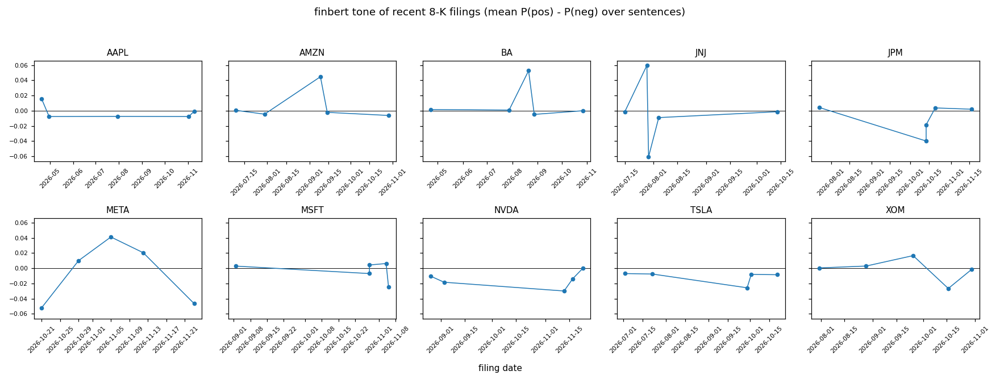

# edgar-sentiment

Tracks the tone of SEC filings over time. Downloads recent 8-Ks from EDGAR
for a 10-company watchlist, scores every sentence with finbert
(ProsusAI/finbert, finance-tuned BERT), and plots each filing's mean
P(positive) - P(negative).

## What it shows

Most filings score near zero: 8-K language is legal boilerplate and finbert
reads it as neutral. The interesting cases are the outliers, e.g. JNJ's
strongly negative late-July filing or JPM's negative mid-October one -
worth reading the filing to see what was actually disclosed.

## What it is not

Not a price signal and not investment advice. Filing tone is descriptive
text analysis. Nothing here tests whether tone predicts returns, and small
sampled-sentence counts (a few dozen per filing) make single scores noisy.

## Layout

- `edgar/client.py` - polite EDGAR client (declared UA, ~8 req/s cap, cached downloads)
- `fetch_sample.py` - last 5 8-Ks per watchlist ticker -> `data/` + `data/filings.csv`
- `score_filings.py` - sentence-level finbert scoring -> `data/scores.csv` (resumable)
- `figures.py` - joins scores to filing dates, writes `report/figures/filing_tone.png`

## Data

SEC EDGAR public APIs (no key): `company_tickers.json`, `data.sec.gov`
submissions, filing documents under `www.sec.gov/Archives`.
